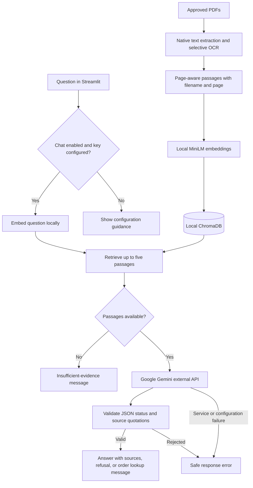

# AI-Powered Document Intelligence & RAG Assistant | Task 1 final report

**AI Consultant Assignment · Option A, GenAI/RAG · 20 November 2026**

## Executive summary

The assistant helps support staff at fictional Fresh Distribution Pvt Ltd find approved answers about shipping, returns, product information, and payment terms. It retrieves relevant PDF passages, asks Google Gemini to draft from those passages when enabled, and shows quotations and page references for agent review. The customer service manager is the decision-maker for a supervised pilot. Sales operations and accounts receivable can use the same reference workflow.

The local prototype is ready for a supervised demonstration in the tested environment. The retrieval run found the expected file first for **20/20** answerable questions. It found the expected page first for **14/15** questions with page labels. A mocked browser run exercised the current interface. A fresh reviewer still needs the complete project snapshot and approved source PDFs. End-to-end answer accuracy across the benchmark and the current UI with live Gemini remain unmeasured.

This assessment uses the Task 1 requirements supplied in the brief. The original assignment PDF was unavailable in the project and was not inspected.

## Solution and design rationale

Staff currently search several files or repeat policy answers from memory. The workflow should make policies easier to find, reduce lookup time, and prevent commitments about discounts, refunds, or order status without supporting evidence. The agent owns the customer response and can check the source before relying on it.

Retrieval-augmented generation (RAG) retrieves source text at question time and supplies it to the model. Updated policies can be indexed again, and filenames and pages remain available for inspection. A keyword-only lookup is easier to operate and keeps all processing local, but spelling variants and paraphrases make search harder for agents. Semantic search handles those variations and still needs evidence review. Fine-tuning would add a training and update cycle and would not by itself provide current policy citations. A general-purpose model without company evidence would leave policy claims harder to verify. The prototype uses local search and adds a network-dependent generation step when the operator opts in.

The question and retrieved passages are sent to Google at the generation step. PDF extraction, OCR, embedding, and retrieval run locally. The UI retains chat for the session. ChromaDB retains passage text, embeddings, and metadata locally across sessions. The uploader stages a temporary PDF for ingestion and removes that copy afterward.

| Layer | Tools and implementation |
| --- | --- |
| Interface | Python 3.12, Streamlit 1.45.1. Operator opt-in via `GEMINI_CHAT_ENABLED` with an API key. |
| Document processing | pdfplumber, pypdfium2, and pytesseract with local Tesseract for pages needing OCR. Page-aware splitting starts at 800 characters with 100 overlap and retries with smaller passages if required by the tokenizer. |
| Retrieval | sentence-transformers `all-MiniLM-L6-v2`, 384-dimensional normalized vectors, local ChromaDB 1.0.9, cosine ranking. |
| Generation | Google GenAI SDK, python-dotenv for environment configuration, structured response and citation validation. The brief reports a prior live run with `gemini-3.5-flash-lite`. |
| Evaluation | Pandas-backed question loader, deterministic retrieval scoring, offline generation replay, Pytest and Streamlit AppTest. |

## Sources and reproducibility

The offline run used these exact local files under `data/uploads/`.

| Fictional source | Coverage | Pages | Indexed passages observed |
| --- | --- | ---: | ---: |
| Delivery & Shipping FAQ.pdf | Zones, standard charges, transit, missed deliveries | 6 | 15 |
| Payment Terms & Invoice Policy.pdf | Approved business credit, invoices, disputes, late fees | 5 | 12 |
| Product Information Sheet.pdf | SKUs, pricing, pack sizes, shelf life and storage | 3 | 7 |
| Returns & Refund Policy.pdf | Eligibility, windows, reporting, refund methods | 5 | 14 |
| Total | | 19 | 48 |

The brief identifies the sources as fictional. The native text scan found only `freshdistribution.example` contact domains. The [data manifest](DATA_SOURCE_MANIFEST.md) records SHA-256 hashes, the targeted screening results, and the inclusion steps. Public source approval remains pending. The local submission snapshot contains the benchmark, mock generation examples, and storage placeholders. The four PDFs remain Git-ignored and were not packaged. To reproduce the reported retrieval results, supply approved copies of these exact files. An explicitly synthetic substitute can demonstrate ingestion and chat mechanics. It requires its own questions and reference labels for evaluation.

The local submission snapshot includes the UI and environment-example changes from the worktree along with the Task 1 additions. Follow the [README](../README.md) for installation and local commands, the [dataset audit](TASK_1_DATASET_AUDIT.md) for label decisions, and the [demo guide](TASK_1_DEMO_GUIDE.md) for the short walkthrough.

## Evaluation results

### Retrieval on the 35-question benchmark

The [retrieval evaluator](../eval/evaluate_retrieval.py) created a fresh index outside the repository using the deployed ingestion and ranking functions, cached embeddings, and top five retrieval. All 19 pages had usable native text. This run did not exercise OCR on the four benchmark PDFs. The parent checked input hashes and removed the temporary database after the worker exited.

The audited CSV has 20 answerable questions, 13 unsupported questions, and two live-order questions. Five answerable rows have no expected page. They count toward file and evidence metrics. The page metrics exclude them. The [audit](TASK_1_DATASET_AUDIT.md) proposes traceable labels separately and retains the original CSV for reported results.

| Metric | Observed result | Denominator |
| --- | --- | --- |
| File hit at 1, 3, and 5 | 20/20 at each depth | All answerable questions |
| Page hit at 1 | 14/15 (93.3%) | Answerable questions with accepted pages |
| Page hit at 3 and 5 | 15/15 at each depth | Answerable questions with accepted pages |
| Page mean reciprocal rank (MRR) | 0.9556 | The same 15 labeled questions. MRR averages one divided by the first accepted page rank. |
| All required strings found at 5 | 20/20 | All answerable questions. Strings may come from different top-five passages. |
| Mean per-question evidence fraction at 5 | 100.0% | Twenty per-question fractions |
| Answerable questions with zero results | 0/20 | All answerable questions |

| Category | Questions | Top-1 similarity min | Median | Max |
| --- | ---: | ---: | ---: | ---: |
| Answerable | 20 | 0.5207 | 0.6434 | 0.7679 |
| Not in documents | 13 | 0.2849 | 0.5107 | 0.6031 |
| Order lookup | 2 | 0.5585 | 0.5854 | 0.6122 |

- **Ranking miss.** Q2 asks how soon spoiled yogurt must be reported. Returns page 3 ranked first at 0.7354 and Product Information page 2 ranked second at 0.5280. Returns page 2, which contains the 24-hour reporting rule, ranked third at 0.4948. Matching product and damage language can outrank the actual deadline.
- **Lower-scoring correct hits.** Q3's UPI refund page ranked first at 0.5207. Q4's COD refund page ranked first at 0.5350. Their page contains the seven- and ten-business-day windows. Exact wording helps distinguish payment methods within a shared table.
- **Higher-scoring insufficient evidence.** Q22 scored 0.6031 on returns page 2. The passage establishes who pays return shipping on excess-stock returns. It supplies no exact fee. Q27 scored 0.5934 on a shipping page describing temperature-controlled availability, while Q23 scored 0.5815 on an invoice-dispute page. Neither score establishes the requested charge. Similarity can be strong on a closely related policy while the specific answer is absent.
- **Order context.** Q20 scored 0.6122 and Q19 scored 0.5585. Both ranked a shipping FAQ page first. A policy PDF cannot establish an individual order's courier, tracking number, or dispatch status.
- **Wording and scope.** All five misspelled or paraphrased questions found their expected file first. Q32's top three were shipping pages 2, 2, and 1. The complete Zone A example is on page 5. These cases illustrate why keyword checks and filename hits alone leave gaps in page selection and answer support. The benchmark has no separate keyword-search run.

A global threshold cannot separate these measured categories reliably. For example, a cutoff above Q22 would reject the correct Q3 result, and an order question scores above both. The threshold and retrieval ranking were left unchanged. The reported results measure retrieval and terms, with no factual accuracy score inferred from them.

### Generation replay and manual review

The [offline evaluator](../eval/evaluate_generation.py) replays raw structured responses against the ordered `RetrievedChunk` passages, using the app's response parser and citation validator. It compares statuses to the existing category labels and reports citation filename/page, source integrity, and exact source quotation. It does not initialize a Gemini client, grade factual claims, or print answers or passage text. The [11 attached replay records](../eval/fixtures/generation_mock.jsonl) are synthetic. They are not live outputs or new document ground truth.

From the project root, run `python -B -m eval.evaluate_generation --records eval/fixtures/generation_mock.jsonl`. Each JSONL record uses an `id` from the evaluation CSV. A response record includes `retrieved`, the ordered list of passages with all `RetrievedChunk` fields, and `response`, the raw model response string or a structured object for fixtures. For captures, preserve the raw string to retain malformed or duplicate-field responses. An error record has `error` with one of `configuration`, `retrieval`, `timeout`, `service`, `model_unavailable`, `rate_limit`, or `authentication`. A deferred record has `skip: true`. Omitted IDs are reported as unrecorded. Point `--csv` to the matching benchmark if it differs from `eval/questions.csv`. Use only a private, authorized capture for real records. The tool grades available recordings offline and provides no live mode.

| Offline replay outcome | Observed result |
| --- | --- |
| Coverage | 11/35 rows recorded, 24 unrecorded |
| Outcomes | 6 valid responses, 2 rejected responses, 2 simulated runtime errors, 1 explicit skip |
| Status agreement | 5/6 valid responses. Q25 returns `answered` for an unsupported express-shipping fee. |
| Status-appropriate citation presence | 6/6 valid responses. The answered cases have citations and the two refusal/lookup cases have none. |
| Citation source and exact quotation | 4/4 returned citations resolve to their recorded source/page and original text. These metrics are conditional on validation accepting the response. |
| Numeric and structured rejection | Q13 truncates Rs. 1,500.50 in a proposed citation. It is rejected. Q11's malformed JSON is rejected. |
| Runtime and skip accounting | Q16 configuration error, Q28 service error, and Q30 skipped. None enter the status denominator. |

In Q6 the supplied quote differs only in whitespace and resolves to original text. The synthetic Q1 and Q6 responses preserve the expected return window and shipping numbers. Q9 passes status and quotation checks while inventing automatic credit of Rs. 100,000 for all customers. The approved-customer restriction and Rs. 50,000 standard limit make that fixture a factual failure. Q25 quotes normal transit duration while inventing a same-day fee. An independent reviewer would flag that claim even though the quote is valid. In Q19, a deliberately fabricated dispatch statement in a mock payload is replaced by the app's deterministic order-lookup message because the mock supplied the `order_lookup` status. This safeguard depends on correct status selection. Q21 exercises the deterministic insufficiency response. These are observations about deliberately chosen mock cases.

The brief reports a previous **4/4 live backend smoke test** on return window, business credit, bulk discount, and specific order dispatch. It reports the correct seven-calendar-day window, the Net 15 and Rs. 50,000 terms, and the expected refusal and lookup behavior. That is historical operator-reported evidence. This stage made **zero live Gemini requests**. The live accuracy, refusal rate, hallucination rate, and current browser-to-Gemini run remain pending.

For each authorized live question, preserve the question ID, exact source version, ordered passages, response or error type, model, and run date in a restricted local record. Review with these labels.

| Dimension | Manual rating rule |
| --- | --- |
| Factual correctness and numbers | **Pass** when amounts, dates, calendar versus business days, time anchors, eligibility, and exceptions agree with the policy. **Partial** for non-material omissions only. **Fail** for wrong values or material qualifiers. |
| Claim-level support | Check every business assertion against cited passages. Mark a claim **supported**, **contradicted**, or **unsupported**. Record hallucinations as unsupported or contradicted claims. A valid quotation proves that the cited words appear in the source. |
| Completeness | Require essential facts and qualifiers from the expected answer and source. Flag omissions that change what an agent would promise. |
| Refusal and order lookup | Require a clear statement of the missing exact information for unsupported questions. Require an authorized lookup and no invented status, courier, or tracking reference for order questions. |
| Failure transparency | Mark missing key, unavailable model, rate limit, service outage, and rejected output separately. An HTTP 503 is an incomplete case. Keep these counts beside the number of completed and manually graded cases. |

Report answer pass/partial/fail among reviewed valid answers, unsupported/contradicted counts per total reviewed claims, refusal and lookup results by category, and operational error/skip counts separately. Fix the reviewed set before running. For a smaller authorized follow-up, a 12-question set such as Q1, Q3, Q6, Q9, Q10, Q13, Q14, Q19, Q20, Q21, Q22, and Q32 covers core policies, exact numbers, both lookup cases, missing evidence, and a spelling variant. That plan would attempt at most 12 Gemini requests with evidence, subject to authorization, quotas, and failure reporting. It was not run.

### Regression and browser evidence

Focused evaluation, generation, and UI tests passed **227/227**. The full suite passed **498/498**, with zero failures or skips and 104 existing ChromaDB deprecation warnings. The tests ran on Python 3.12.10 with Pytest 8.3.5. They used mocks for generation and temporary storage. Existing cases cover missing key, API failure, unavailable model, malformed response, unknown IDs, wrong-document and duplicate evidence, wrong numbers, exact and whitespace-equivalent quotes, and empty evidence. The additional adversarial test exercises the public generation function with a valid quote and an unrelated financial claim, confirming the absence of claim-level entailment validation.

The [finalization rerun](TASK_1_VALIDATION_EVIDENCE.md) reproduced these test and evaluation counts. The locally configured model differs from the historical live-test model. Its current availability and the live UI remain unverified. Confirm the operator's intended model before any separately authorized run.

The Chrome check launched the actual Streamlit app path on localhost with a process-local retrieval, database, and Gemini fixture. With the environment opt-in off, the document list appeared and chat and quick prompts were disabled with zero calls. With opt-in on and a placeholder key, a quick prompt, manual Enter, source display, refusal, order lookup, clear chat, and browser refresh worked. Four deliberate mock submissions were logged, with no duplicate requests during refresh and no server tracebacks. The verification did not open the persistent index. This evidence covers interaction and rendering. Current live Streamlit-to-Gemini verification is pending the operator steps in the [demo guide](TASK_1_DEMO_GUIDE.md#prepare).

## Responsible AI and limitations

| Risk | Implemented control and remaining boundary |
| --- | --- |
| Hallucination, wrong numbers, or stale policy | Prompt instructions ask for answers from the supplied evidence and preservation of exact numbers. Humans still verify claims and dates against the current approved policy before promising refunds, prices, or terms. The prototype has no source approval/version workflow. |
| Wrong citation | Source IDs bind citations to retrieved passages. The validator confirms an exact original quote or a unique whitespace-equivalent span, then returns the original text and the stored filename/page. Its checks do not establish that every generated claim follows from the quotation. |
| Prompt injection | System instructions are separate from untrusted document and question fields, and tools and automatic function calling are disabled. Test fixtures attempt to override instructions and request secrets. Tests cover prompt construction and parser behavior. They do not establish that a live model resists every injection. |
| Missing evidence and order status | Empty retrieval can return an insufficiency response locally. Structured refusal and order-lookup states use fixed safe text. The model still chooses the status when evidence is supplied. There is no live order-management integration. |
| Private documents and credentials | Chat defaults off. Operator opt-in and a key are required by the UI service. The app discloses external excerpt transfer. The key is sourced from the environment or ignored `.env` and runtime errors are sanitized. Temporary PDFs are cleaned up. Local storage continues to hold document content until records are removed. Review sharing authorization, provider terms, local protection, and retention for real use. |
| PDF parsing and OCR | The upload path checks extension, size, and PDF signature. Native extraction and selective OCR have regressions. Complex tables, scans, and hostile PDFs can still cause extraction or parsing problems. Use approved sources, check numeric text visually, and isolate parsing with resource limits before production. |
| Narrow data, bias, and confidence | Four fictional English documents and two order cases provide limited coverage. Evaluate regional terms, domains, roles, languages, formatting, and scanned examples before a wider deployment. Similarity scores are not confidence probabilities. |

The POC is a local single-operator workflow with a shared index. It provides no tenant or role isolation. Encryption, regulatory compliance, universal OCR accuracy, and production load performance were not verified.

## Illustrative business value

Estimate capacity freed per month as **repeat questions × safely assistable share × (manual minutes − assisted minutes, including review) / 60**. Multiply hours by staff cost per hour for capacity value. Subtract illustrative recurring operating costs for net monthly capacity value. Unassisted cases still follow the normal workflow. These are assumptions and capacity estimates, not measured savings or cash reductions.

| Scenario | Repeat questions/month | Safely assistable | Manual / assisted minutes | Hours freed | Capacity at Rs. 450/hour | Recurring cost | Net monthly capacity value |
| --- | ---: | ---: | ---: | ---: | ---: | ---: | ---: |
| Conservative | 400 | 35% | 5 / 3.5 | 3.5 | Rs. 1,575 | Rs. 1,000 | Rs. 575 |
| Base | 600 | 50% | 6 / 3 | 15.0 | Rs. 6,750 | Rs. 2,000 | Rs. 4,750 |
| Optimistic | 800 | 65% | 7 / 3 | 34.7 | Rs. 15,600 | Rs. 3,500 | Rs. 12,100 |

Recurring costs are illustrative API and infrastructure assumptions. One-time deployment, training, and change costs are excluded. A supervised pilot can compare a matched sample of manual and assisted tickets, including review, escalations, corrections, and repeats. Log the actual usage cost and unsupported-claim rate. Have a policy owner agree acceptable error and escalation rates before expanding use. Treat time freed as available capacity unless staffing or budget actually changes.

## POC to production

| Phase | Scope and decision |
| --- | --- |
| Local POC, current | Fictional PDFs, local ChromaDB, Streamlit, Gemini opt-in, controlled demo questions, offline evaluation, and the historical four-question backend check. Suitable for a supervised demo with approved sources. |
| MVP pilot | Set up an approved document repository with owners, revision history, and controlled updates. Add access control, feedback, human review for consequential answers, a larger held-out question set, monitoring and usage logs with access controls, and retention/deletion procedures. Validate handling time and material errors before broadening the pilot. |
| Production | Secure identity and role-based document authorization, central environment and secret management, data protection and provider review, rate limiting, observability, ongoing quality and cost monitoring, incident handling, resilient deployment, document governance and version-aware citations, load testing, and user acceptance testing. If order support is necessary, design a separate authorized ERP/order API integration. |

Local storage reduces operational complexity and helps keep retrieval on the machine. Central access control and document governance cost more to operate and are needed when staff have different document permissions. Human review adds handling time and limits unsupported customer commitments. Use the pilot to decide where that trade-off is worthwhile.

## Task 1 submission readiness

| Requirement | Evidence | Status | Remaining action |
| --- | --- | --- | --- |
| 1. Business problem and decision-maker | Executive summary and supervised pilot rationale | COMPLETE | — |
| 2. Data sources and privacy | Source inventory and local checks, [dataset audit](TASK_1_DATASET_AUDIT.md), responsible-AI review | BLOCKED | Supply the approved fictional source bundle or a clearly labeled alternative with its own evaluation. |
| 3. Technical approach and alternatives | Architecture and rationale for RAG, keyword lookup, and fine-tuning trade-offs | COMPLETE | — |
| 4. Tools, libraries, and models | Stack inventory and [pinned dependencies](../requirements.txt) | COMPLETE | — |
| 5. Working code and short demo | Local project snapshot, mocked browser verification, [demo guide](TASK_1_DEMO_GUIDE.md) | PARTIAL | Confirm source availability and run a separately authorized live browser walkthrough if required as evidence. |
| 6. Evaluation including accuracy and hallucination checks | Retrieval rerun, synthetic replay, adversarial regression, manual rubric | PARTIAL | Independently grade a separately authorized live answer sample. Keep factual accuracy and operational failures separate. |
| 7. Responsible-AI notes | Documented privacy and quality controls, narrow coverage, and failure cases | COMPLETE | — |
| 8. Limitations and production path | POC, MVP, and production roadmap | COMPLETE | — |
| 9. Measurable expected value | Three illustrative scenarios and a pilot measurement plan | COMPLETE | Measure assumptions in the pilot. |

**Mandatory for release** Review the prepared project snapshot, include the approved fictional PDFs or a reproducible, labeled alternative, and validate the submitted bundle from a fresh environment.

**Important for stronger evidence** Obtain explicit authorization for live excerpt transfer before capturing the current browser demo or grading additional answers. Review proposed missing page labels with the source owner and version any updated benchmark separately.

**Optional improvement** Add document-version identity and additional paraphrases to a later pilot benchmark. Keep this benchmark frozen for comparison.

The evaluation left benchmark PDFs/CSV, existing RAG logic, `.env`, and persistent vector data unchanged. Temporary databases were removed. No live requests, new dependencies, commits, or pushes were made for this stage.
