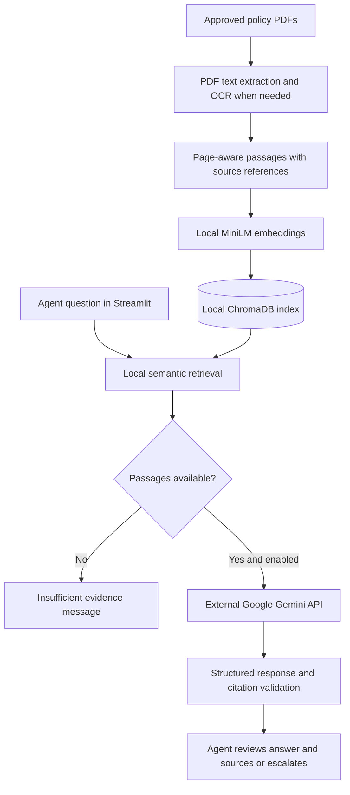

# Fresh Distribution | AI adoption case study

**Client scenario** Fresh Distribution Pvt Ltd, a fictional distributor operating across several Indian states  
**Prepared for** Managing Director, COO, CFO, sales leadership, Customer Support, and IT/ERP  
**Decision** Authorize discovery and consider a supervised policy-assistant pilot

## 1. Executive summary

Fresh Distribution faces slow order-to-cash, repetitive support queries, and unreliable monthly demand forecasts. Leadership wants to improve these processes with a limited budget and no data science team. Deploying solutions for all three problems at once would commit scarce IT capacity before data access, ownership, operating procedures, and baselines are established. It would also expose the company to different risks at the same time, from an incorrect customer promise to an incorrect collection notice or purchase plan.

Start with a supervised policy assistant for support agents. It can use a narrow set of approved policy documents without an ERP connection. The existing AI-Powered Document Intelligence & RAG Assistant prototype demonstrates PDF ingestion, local search, grounded draft answers, and source quotations. Its retrieval and mock-browser checks establish technical feasibility for a local demonstration. They do not establish safe live performance on company documents. The illustrative base case frees 15 hours of staff capacity per month and values that capacity at Rs. 4,750 net of assumed recurring costs. This figure is a pilot hypothesis.

Approve discovery, nominate a policy owner and IT counterpart, and permit a small internal pilot only after approved documents, external processing, and success criteria are agreed. Keep invoice follow-up next in the queue if finance can establish reliable ERP and payment records. Review the investment decision after the pilot has measured answer quality, agent time including review, usage, and actual cost.

## 2. Business context and outcomes

The scenario describes a distributor with about 400 employees. ERP software, Excel files, and a shared support inbox hold different parts of the operating record. A support agent may know what the returns policy says but still need finance or logistics to confirm the facts of a specific transaction. Leadership needs to separate policy lookup from transaction execution and assign an owner to both.

| Problem | Operational effect | Outcome to measure |
| --- | --- | --- |
| Slow order-to-cash | Delayed invoicing, unresolved disputes, or slow follow-up can tie up cash and create work for finance and sales. Discovery must distinguish the largest bottleneck. | Median days from order to collected payment, broken down into order-to-invoice and invoice-to-cash, plus aged receivables and disputed balances. |
| Repetitive support | Agents repeatedly find the same policy and may quote different versions. A routine query can wait behind work that needs judgment or access to an order. | Time per eligible policy query, first-response time, repeat contacts, and policy errors. |
| Inaccurate forecasts | Errors can lead to purchases that tie up stock or leave popular products unavailable. Returns, promotions, stockouts, and seasonal patterns can distort the signal from sales. | Forecast error and bias by product and region, plus stockout and inventory indicators. |

Actual volumes, margins, salaries, ERP capabilities, and current KPI values are unknown. All numerical business inputs in this proposal are illustrative estimates for discovery to replace.

## 3. Discovery plan

Use a 90-minute first session. Spend the first 15 minutes agreeing the sponsor, decision date, and risks leadership will not accept. Spend 30 minutes on one real support journey and one recent invoice journey, with staff showing where decisions and delays occur. Use 25 minutes for data ownership, access and integration constraints, then 20 minutes to agree the baseline sample, approval owners, and a pilot decision. Interview planners separately if demand data needs a deeper review. The first meeting should answer four questions: how many repetitive queries arrive, how long agents spend on them, who owns the current policy, and which content may be sent to an external provider.

| Stakeholder and purpose | Questions | Fact or decision needed |
| --- | --- | --- |
| MD / COO, sponsor and process authority | Which outcome matters first and why? What budget and internal time are available? What customer or data incident requires a stop? | One sponsor, one prioritized outcome, a review date, and the escalation path. |
| CFO / finance lead, collections and commercial rules | When does an order become an invoice and then cash? How many invoices are overdue? How are partial payments, credit notes, disputed balances, and grace periods recorded? | Baseline timeline and aging definitions, finance sign-off on credit and fees, and criteria for moving invoice automation forward. |
| Support lead and agents, actual workflow | Monthly inbox volume? What share repeats? Which topics dominate? How are reopens, escalations and handling time recorded? Which answers need supervisor approval? | A sampled baseline, a set of eligible policy queries, a pilot group, and a clear exception workflow. |
| Sales operations, catalog and promises | Which price lists and regional terms are authoritative? How are exceptions approved? When can an agent quote a price without escalation? | Approved catalog and policy versions, exceptions excluded from automation, and a document refresh owner. |
| ERP / IT administrator, integration and operation | What interfaces exist, can a read-only account be scoped, and are statuses and IDs stable? Who maintains credentials and handles incidents? | An ERP capability assessment, the cost of a supported connection, and named operational ownership. |
| Inventory / planning manager, forecast interpretation | What forecast accuracy can be reproduced from prior versions? Which SKUs have intermittent demand, stockouts or promotions? Which Excel edits change a purchase plan? | A baseline method and historical data fitness criteria before forecasting work begins. |
| Data owners and privacy/security representative, authorization | Who approves access and external processing? What document versions are usable? Which fields are restricted, where may data be stored, and when must it be deleted? | An approved source inventory, processing decision, retention rules, and a named incident contact. |

Request a minimal, redacted sample of inbox tickets with topic, handling time, reopen and escalation fields. Request approved policy PDFs, catalog versions, returns/refunds rules, and owners for the pilot. Discovery for later work requests invoice/payment samples and aged balances, order lifecycle events and returns/refunds history, inventory snapshots and historical sales, ERP field definitions and interface documentation, process KPIs, access policies, and data quality reports. Use read-only access through approved channels. Redact customer and employee identifiers from review samples, record the approval and retention date, and keep transactional data out of the policy assistant's pilot index. The data owner approves any provider transfer before real data is used.

## 4. AI readiness assessment

Every rating is **provisional** and requires discovery validation. The scale runs from 1 (major gaps) through 2 (early), 3 (partially ready), 4 (mostly ready), and 5 (well established). A low rating reflects a delivery concern given the scenario. No aggregate is calculated because an authorization gap can block a pilot regardless of other scores.

| Area | Provisional | Scenario basis and unknown | Improvement before expansion |
| --- | ---: | --- | --- |
| Data quality | 2 | ERP and Excel may represent the same event differently. Completeness, reconciliation rates, and Excel provenance are unknown. | Profile missing fields and duplicate IDs, reconcile representative records, and track fixes with owners. |
| Data availability | 3 | The scenario names three source systems. Policy ownership and right to use historical extracts are unverified. | Start with a signed-off policy set and an inventory of reports and access owners. |
| ERP/API integration | 2 | An ERP exists. Supported APIs, latency, stability, and permission granularity are unknown. | Test a read-only extract with IT before promising order or invoice integration. |
| Process standardization | 2 | Repetitive work suggests recurring rules, while exception routes and regional scripts are unverified. | Document a shared answer and escalation workflow with support and finance. |
| Internal technical skills | 1 | The business has no data science team. IT's capacity for operating and monitoring a pilot is unknown. | Assign an IT operator and backup, and budget for handover and simple operational checks. |
| Data governance | 2 | Information is spread across sources. Authority over versions, retention, and correction is unknown. | Name policy owners, set version and review dates, and define the correction and withdrawal process. |
| Security and privacy | 2 | Use of an ERP does not establish scoped access or authorization for a model provider. | Approve data classification, external processing, access boundaries and an incident contact. |
| Leadership sponsorship | 3 | Leadership wants AI and has a budget constraint. Sponsor availability and tolerance for a time-boxed pilot are unconfirmed. | Agree a sponsor, funding ceiling, and explicit go/no-go decision. |
| Change readiness | 2 | Agents already work in a shared inbox. Coaching effort, incentives, and willingness to inspect sources are unknown. | Involve agents in workflow design and give them a documented fallback and feedback channel. |
| Monitoring and measurement | 2 | The scenario describes outcome problems without verified baselines, audit logs, or service targets. | Agree definitions and sample the manual process before pilot rollout. |

**Readiness conclusion** A bounded policy-only feasibility check is reasonable once an approved source set and an owner exist. Transaction automation and operational forecasts depend on cleaner matched ERP data, verified permissions, and measurable baselines.

## 5. Use cases and prioritization

| Use case | Users, outcome and approach | Data, complexity and key risk |
| --- | --- | --- |
| Policy knowledge assistant | Support and sales operations find shipping, returns and catalog guidance faster. Retrieve from approved documents, draft with citations, and let agents send or escalate. | Versioned PDFs and sampled tickets. Low pilot integration effort. Wrong policy or vendor disclosure requires review and approved sources. |
| Invoice and payment follow-up | Finance prioritizes overdue accounts and drafts reminders. Use ERP aging rules and approved templates, with optional assisted drafting and staff approval. | Invoice, receipt, dispute and credit-note records with communication permissions. Moderate integration. Incorrect reminders harm trust and can target already settled or disputed balances. |
| Demand forecasting | Planners improve order recommendations. Start with seasonal and simple baseline forecasts and compare against time-ordered history before deployment. | Historical SKU sales, stockouts, returns, promotions and inventory by region. High data preparation effort. Overbuying and shortfalls remain material risks. |
| Order-status self-service | Support could handle fewer “where is my order” contacts. Use a separate authenticated read-only ERP or logistics connection with scoped customer identity. | Stable order events, identity mapping, and carrier interfaces. High integration and privacy risk. Live status cannot come from policy PDFs. |
| Reconciliation and exception detection | Accounts receivable sees mismatches faster. Match orders, invoices and receipts using explicit accounting rules, with exceptions queued for review. | Matched records, usable IDs and defined tolerances. Moderate integration. False matches and mistaken financial postings require review and an audit trail. |

Score each dimension from 1 to 5. Higher impact means greater plausible operational benefit. Higher ease means less integration and staff effort. Higher data readiness means sources are more likely to be usable after approval. Higher risk manageability means lower residual risk or clearer controls. The weighted score is `impact × 0.35 + ease × 0.25 + data × 0.25 + manageability × 0.15`. Impact remains central, while ease and data collectively carry half the weight because budget and operating capacity are constrained. Authorization and severe risk remain go/no-go gates regardless of score.

| Rank | Use case | Impact 35% | Ease 25% | Data 25% | Risk 15% | Weighted total / 5 |
| ---: | --- | ---: | ---: | ---: | ---: | ---: |
| 1 | Policy assistant | 4 | 5 | 4 | 4 | 4.25 |
| 2 | Invoice and payment follow-up | 5 | 3 | 3 | 3 | 3.70 |
| 3 | Reconciliation and exceptions | 4 | 3 | 3 | 3 | 3.35 |
| 4 | Demand forecasting | 5 | 2 | 2 | 3 | 3.20 |
| 5 | Order-status self-service | 4 | 2 | 3 | 2 | 2.95 |

Each score has a rationale in Appendix A. If collection data, ease, and risk manageability improve to 4 in discovery, invoice follow-up scores 4.35 and merits reconsideration.

## 6. Recommended first use case and architecture

Pilot the assistant with a small support team and approved shipping, returns, billing, and product policies. Agents ask a policy question, check the cited source and eligibility, and decide what to send. The prototype reduces proof-of-concept work because the UI, ingestion, retrieval, and citation checks already run locally. Keep credit exceptions, disputed charges, and specific order status with the responsible team. There is no ERP access, automatic reply, policy override, or authority to make a binding commitment. The policy owner can withdraw a stale document and an agent can revert to manual lookup if quality is poor.

### Current prototype

Extraction reads the PDF text and OCR handles pages that need image recognition. Splitting by page preserves where a quotation came from. The local embedding model creates a search representation of each passage and question. ChromaDB returns the nearest passages. When chat is enabled and configured, the question and relevant retrieved excerpts are sent to Google Gemini. The app checks the response format and source quotations and displays them with filename and page. A genuine quotation can still accompany an unsupported claim. Human review remains part of the workflow, especially for prices, credits and refund deadlines. See the [Task 1 report](../Task_1_RAG_Application/docs/TASK_1_FINAL_REPORT.md) for measured retrieval evidence and known failures.

### Proposed MVP and production controls

Approve and version documents before ingestion, enforce identity and permissions before retrieval, and scope storage and results by role. Use controlled service credentials, provider and privacy review, encryption and retention requirements agreed with IT, and restricted operational logs that avoid unnecessary customer text. Separate review and feedback from the live response. Record source revision and review date so a policy owner can trace and undo stale guidance. Monitor service failure, usage and quality. Defer transaction-specific access until a separately authorized ERP design tags each request to the authorized customer and logs access. These capabilities are proposed for later phases.

Retrieval-augmented generation suits policies that change. Updating an approved document is easier to trace than retraining a model and deciding which revision it learned. Prompting defines response boundaries, source expectations and refusal rules. It cannot supply a current policy by itself. Fine-tuning needs curated examples, training and maintenance effort, and would still require fresh references for business terms. A keyword index is a useful low-cost fallback, especially for precise codes. Semantic retrieval helps with paraphrases and typos. Both approaches require source review when a similar passage lacks the requested fact.

## 7. Build versus buy

| Choice | Cost and time | Fit and trade-offs |
| --- | --- | --- |
| Build the full stack | More engineering and operations effort. Local model hosting and support would add recurring internal work and lengthen rollout. | Strong workflow and data control, but a small IT team would own maintenance, security, uptime and evaluations. |
| Buy a helpdesk or enterprise knowledge product | Faster if support channels and access fit existing tools. Recurring license and integration costs depend on users, usage and contract terms. | Standard admin and support can reduce internal maintenance. Assess flexibility, data retention, regional requirements, export and vendor dependency. |
| Hybrid, recommended for pilot | Reuse local retrieval and the existing UI, with a managed Gemini API and a usage cap. Initial effort centers on approvals, ingestion and review. | Retain document selection, source checks, business rules and workflow. The model provider adds external transfer, quota, outages, and dependency risk. |

Use the hybrid route for a limited pilot. Compare a buy option during MVP discovery if the support platform already offers approved integration and administration. Obtain comparable quotations and terms including costs at typical usage, allowed data, exit/export and support commitments. A local model is an alternative if excerpt transfer cannot be approved, with its own cost and quality evaluation. No current vendor prices are assumed here.

## 8. ROI model and pilot measurement

These assumptions extend the [Task 1 capacity model](../Task_1_RAG_Application/docs/TASK_1_FINAL_REPORT.md#illustrative-business-value) without changing its repeat-query volumes, handling times, rate, or recurring costs. Total support volume and repeat share are illustrative decompositions. The safely assisted share means cases actually used with human review and safely completed. Assisted minutes include review. Rs. 450 per hour is a modeling rate, not a known salary. Monthly recurring amounts are assumed API and infrastructure costs, not quotes.

| Input | Conservative | Base | Optimistic |
| --- | ---: | ---: | ---: |
| Monthly support queries | 1,000 | 1,200 | 1,600 |
| Repetitive share and count | 40%, 400 | 50%, 600 | 50%, 800 |
| Safely assisted share of repeats and count | 35%, 140 | 50%, 300 | 65%, 520 |
| Manual minutes per eligible question | 5 | 6 | 7 |
| Assisted minutes including review | 3.5 | 3 | 3 |
| Review portion of assisted minutes | 1.5 | 1.5 | 1.5 |
| Gross reduction before review, minutes | 420 | 1,350 | 2,860 |
| Review effort, minutes | 210 | 450 | 780 |
| Staff hours released after review | 3.5 | 15.0 | 34.7 |
| Staff capacity value per month | Rs. 1,575 | Rs. 6,750 | Rs. 15,600 |
| Recurring costs per month | Rs. 1,000 | Rs. 2,000 | Rs. 3,500 |
| Net monthly capacity value | Rs. 575 | Rs. 4,750 | Rs. 12,100 |
| Annualized net capacity value at steady use | Rs. 6,900 | Rs. 57,000 | Rs. 145,200 |
| Capacity-equivalent payback at assumed Rs. 30,000 one-time cost | 52.2 months | 6.3 months | 2.5 months |

Repeat volume equals monthly queries times the repeat share. Assisted volume equals repeat volume times the safely assisted share. Gross minutes before review equal assisted volume times manual minutes minus drafting and lookup minutes, with that difference calculated per case. Review effort equals assisted volume times review minutes. Divide the difference by 60 for hours released. Multiply unrounded hours by Rs. 450, then subtract recurring costs. Annualized value is net monthly capacity value times 12 before the one-time cost. Illustrative payback is one-time cost divided by positive net monthly value. In the base case, `300 × (6 − 3) / 60 = 15 hours`, worth `15 × 450 − 2,000 = Rs. 4,750` per month net.

Released capacity can help absorb workload. It does not automatically reduce payroll or prove cash savings. Lower volume or adoption reduces capacity in direct proportion. In the base case, an extra 30 seconds of review costs 2.5 hours or Rs. 1,125 of monthly capacity. An extra Rs. 1,000 of operating costs reduces net capacity value to Rs. 3,750. Incorrect or escalated answers can consume more review time and reduce safe coverage. Pause on material errors and update the model using observed results from matched manual and assisted tickets, including escalations, corrections, staff time and provider costs.

## 9. Roadmap and ownership

The fictional prototype already exists. Each phase below is proposed client work, with indicative elapsed time and combined team effort. Resource and approval timing may vary.

| Phase | Objective and deliverables | Owners, effort and dependencies | Exit decision |
| --- | --- | --- | --- |
| 0 · Discovery and data approval | Baseline sample, source inventory, approval boundaries, pilot group and failure policy. | COO sponsor, support lead, finance and IT/data owners. 1–2 weeks, 5–8 person-days. Requires access to process owners and approved samples. | Go only with policy and processing approval, baseline definitions, accountable owners, and a budget ceiling. |
| 1 · Controlled POC | Run the policy assistant for a small agent group using approved documents. Test held-out questions, collect corrections and compare with matched manual cases. | Support lead and reviewers with IT backup. 2–3 weeks, 8–15 person-days. Requires vetted PDFs, configured costs, training and a manual fallback. | Go if quality, safety, usage and handling-time targets hold. Stop or redesign if material commitments are wrong or permissions cannot be enforced. |
| 2 · Business MVP | Version documents, enforce role-scoped access, add restricted feedback and monitoring, strengthen the held-out set, and set retention and incident procedures. | IT/ERP and support process owners with privacy and finance input. 6–10 weeks, 25–45 person-days. Requires funding, reliable policy updates and access design. | Expand only after permissions, recovery, quality gates and reviewer workflow pass acceptance testing. |
| 3 · Production rollout | Roll out in waves with governed sources, budget controls, incident response, quality monitoring, operational ownership and support. | COO, IT operations, support leadership, finance and security. 8–12 weeks, 40–75 person-days. Requires tested security, load, rollback, reporting and user acceptance. | Continue if quality and operating costs stay within approved bounds. Require separate justification and authorization for any ERP integration. |

## 10. Proposed pilot scorecard

Measure a frozen review set and a matched manual/assisted ticket sample. Label counts and denominators and keep blocked or service-failure cases visible. Targets are proposed starting gates. The steering group should confirm them once baselines are known. Small samples do not establish safe performance across all scenarios.

| KPI | Definition and measurement | Baseline needed | Proposed target, owner and cadence |
| --- | --- | --- | --- |
| Grounded-answer accuracy | Independently reviewed answers with correct material facts and cited support divided by reviewed answerable responses. | Manual answer sample and held-out labeled questions. | ≥90% with zero material policy or financial errors observed. Support policy owner, weekly. |
| Appropriate refusal | Safe refusals divided by explicitly unsupported review cases, with order lookup assessed separately. | Set of unsupported and live-status questions. | ≥90% refusal and all reviewed order cases routed without invented status. Support lead, weekly. |
| Citation integrity | Valid source locations and quotations divided by displayed citations, including a manual page spot-check. | Approved document snapshot and verified pages. | 100% of reviewed citations recoverable. Policy owner, weekly. |
| Staff time per query | Median handling minutes including review, corrections and escalations for matched eligible queries. | Timestamped normal handling by topic. | ≥20% reduction, conditional on quality. Support operations, weekly. |
| Adoption | Eligible pilot tickets for which an agent chooses the assistant divided by all eligible pilot tickets. | Eligible volumes and active agent participation. | ≥50% by end of the pilot. Support lead, weekly. |
| Human escalation | Share routed to supervisors, finance, logistics, or manual fallback by reason. | Existing escalation rate and root causes. | Route all identified exceptions. Review the rate without penalizing necessary escalation. Support lead, weekly. |
| Unsupported-answer incidents | Count material unsupported claims in reviewed or customer-facing answers and record severity. | Historical corrections and audit sample. | Zero material incidents observed, with any such incident investigated before resumption. Policy owner, each incident and weekly. |
| API cost per useful answer | Provider spend divided by valid assisted cases confirmed useful, including failed-call spending in the numerator. | Cost and traffic estimates and an agreed cap. | Within the Phase 0 budget ceiling and measured capacity case. IT and finance, weekly. |
| Source freshness | Share of pilot documents with an owner, current approved version and unexpired review date. | Source inventory and review dates. | 100% of the pilot set. Document owners, before indexing and weekly. |
| Customer response time | Median time to first useful reply on matched eligible tickets. | Inbox timestamps and eligibility groups. | Improvement from baseline without transferring delay to escalated cases. Support operations, weekly. |

## 11. Risks and responsible AI

The most consequential pilot risks are unsupported commercial commitments, stale policies, and sharing content without approval. Assign review and withdrawal owners before launch. Keep order status, accounting postings, refunds, price exceptions and customer commitments under the responsible human process. The assistant drafts from the supplied policy and can route a question requiring live data. It cannot look up an order through the existing prototype or guarantee correctness. Staff retain control of the answer. Appendix B records additional risks and residual limitations.

## 12. Leadership decision

Approve Phase 0 with a COO sponsor, a support lead, policy and finance reviewers, and an IT operator. Provide current approved policies, a redacted support sample and its handling-time baseline, and written approval for any external processing. If the data and control gates pass, approve a time-boxed assisted pilot with a spending ceiling and a review date. Move to MVP only after recorded improvements in handling time, safe use, and evidence quality justify the operating cost. Pause for unapproved data transfer, an uncontrolled permissions gap, repeated unsupported claims, or material financial errors. If the policy set is unsuitable or expected value is weak, redesign the pilot or advance the ERP-supported invoice follow-up discovery instead.

## Appendix A. Score rationale

The policy assistant can reduce common lookups (4) with an existing prototype and no order integration (5), and its policy inputs are narrower than ERP history (4). Agent review and approved documents make the pilot risk manageable (4). Finance collection impact could be higher (5), while reconciliation of settlements and disputes makes delivery moderate (3), requires usable records (3), and calls for message approval (3). Exception detection has narrower impact (4), moderate workflow effort (3), existing but unverified accounting records (3), and human controls over postings (3). Forecasting addresses a substantial inventory decision (5), but preprocessing and evaluation are demanding (2), sales alone omit stockout and promotion context (2), and planners can override outputs (3). Order lookup clears a common bottleneck (4), requires secure live integration (2) with unverified but plausible ERP events (3), and creates cross-customer exposure risk (2).

## Appendix B. Risk register

Likelihood and impact are qualitative planning judgments. The sponsor and responsible teams should confirm them in discovery.

| Risk | Likelihood / impact | Mitigation and owner | Residual limitation |
| --- | --- | --- | --- |
| Hallucinations and unsupported commitments | Medium / High | Require source and claim review before customer use. Escalate missing, contradictory or exceptional policies. Support lead. | A valid citation can accompany an invented claim. |
| Prompt injection and hostile PDFs | Medium / High | Allowlist documents, separate untrusted text from system instructions, test injection, isolate parsing before production. IT and security. | Instructions and validators provide partial defense. |
| Wrong financial or policy terms | Medium / High | Require finance to review credit, charges, and unusual refund cases. Check numbers and policy qualifications in source. Finance and policy owners. | Agents can miss subtle qualifiers. |
| Stale documents | Medium / High | Maintain owner, revision and expiry; remove superseded material and recheck evidence. Document owners. | Changes between reviews require a reliable withdrawal procedure. |
| Sensitive data and API transfer | Medium / High | Approve sources and provider terms, minimize excerpts, redact samples, and keep secrets in protected configuration. Privacy and IT. | Authorized external processing still occurs and needs oversight. |
| Unauthorized access | High / High if exposed publicly | Keep POC supervised and local. Add identity, role-based filtering and audit before shared access. IT/security. | POC has a shared local index. |
| Bias or unequal help by region, language or document style | Medium / Medium | Sample regional wording, languages and formats; compare quality and escalation. Support and data owners. | Narrow fictional evaluation gives limited coverage. |
| OCR and retrieval misses | Medium / High | Check important numbers visually, hold out scans and paraphrases, route uncertain cases to manual lookup. Policy owner and IT. | Related passages can rank higher than the exact rule. |
| Cost and vendor dependency | Medium / Medium | Budget caps, usage tracking, portable sources and exportable evidence. Finance and IT. | Changing model or vendor requires new evaluation. |
| Service outages | Medium / Medium | Display clear errors, monitor failures, and revert to manual policy lookup. IT and support. | Capacity benefit declines during outages. |
| Staff adoption and change management | Medium / Medium | Train agents on source review, capture feedback, preserve escalation, and name a supervisor to review incidents. Support lead. | Time savings depend on usage and review effort. |
| Compliance and oversight | Unknown / High | Request the appropriate privacy, security and contractual review before external use, with retention and incident decisions recorded. Sponsor and privacy lead. | The proposal does not establish regulatory compliance. |
